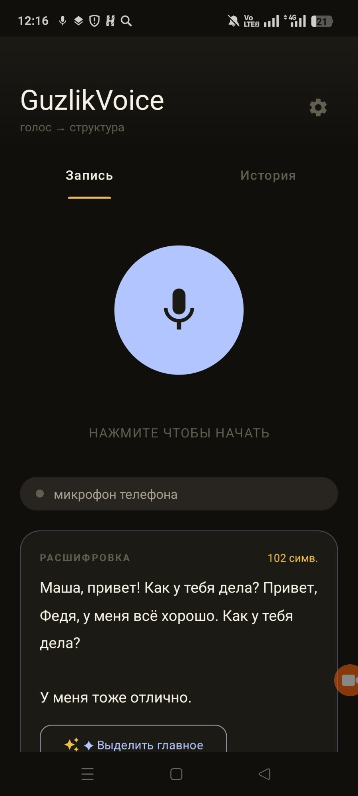
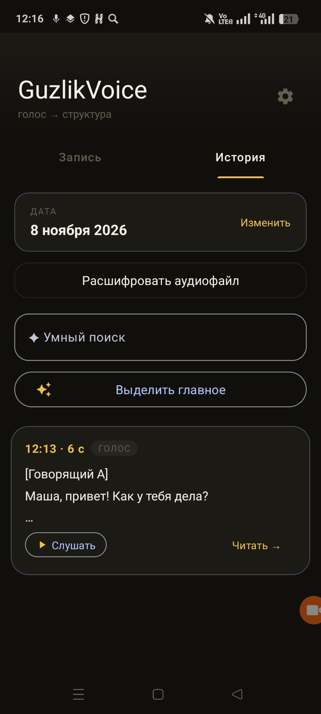
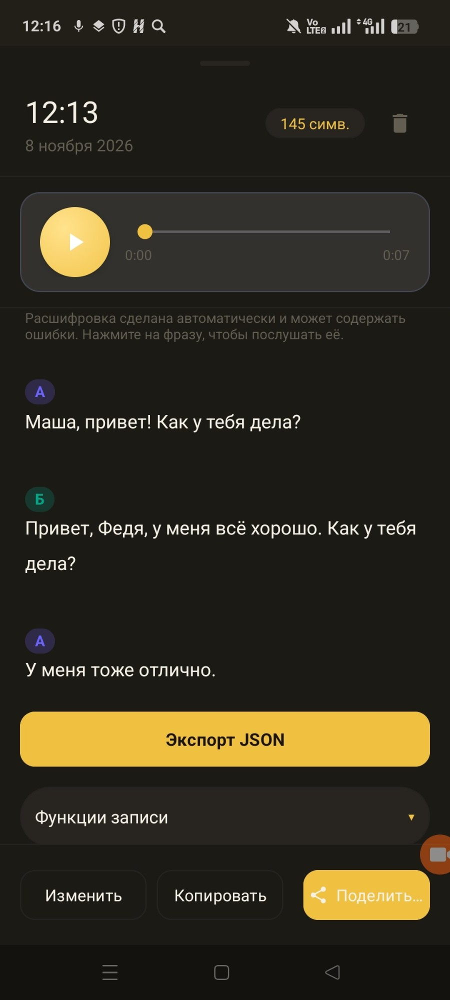
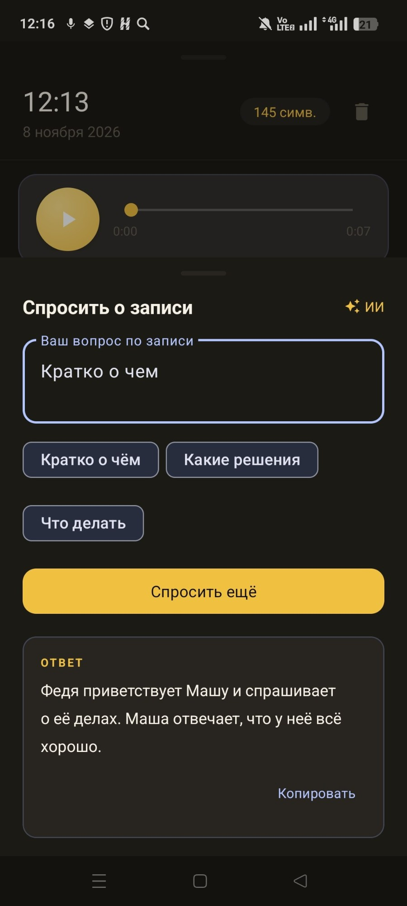
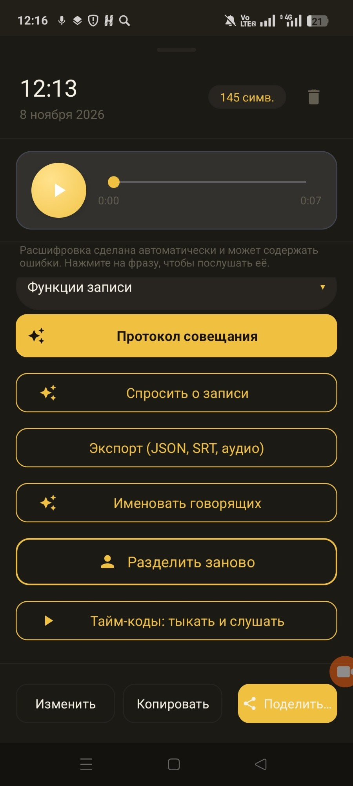
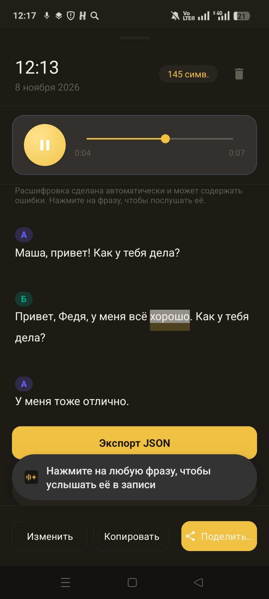

# GuzlikVoice

### Offline speech-to-structure for Android · Nuclear IT Hack 2026

GuzlikVoice превращает аудиозапись в проверяемую расшифровку с говорящими, временными метками и JSON-экспортом.
Вся обработка выполняется на телефоне: GigaAM распознаёт русскую речь, диаризация восстанавливает говорящих,
а Gemma отвечает на вопросы по записи. Интернет для работы не нужен.

[Видео работы](https://drive.google.com/file/d/1QdFcU4_UfRCXNR9R1hNgWyATeJtJgbEA/view?usp=sharing) · [Скачать APK 4.0.9](https://github.com/FedorSolodkin/NuclearGuzlik-/releases/tag/guzlikvoice-contest-v4.0.9) ·
[Архитектура](docs/ARCHITECTURE.md) · [Результаты](docs/TEST_RESULTS.md) · [Ограничения](docs/LIMITATIONS.md)


## Что умеет приложение

- импортировать аудио и записывать речь с микрофона;
- работать полностью офлайн после установки APK;
- автоматически находить одного или нескольких говорящих, а также принимать заданное число;
- показывать текст по репликам, переходить к ним в плеере и редактировать результат;
- экспортировать строгий JSON формата задания;
- отвечать на вопросы по расшифровке локальной Gemma.

## Как проверить за пять минут

1. Установите [конкурсную APK 4.0.9 со встроенными моделями](https://github.com/FedorSolodkin/NuclearGuzlik-/releases/tag/guzlikvoice-contest-v4.0.9). Размер, SHA-256 и состав лежат в [manifest.json](artifacts/apk/manifest.json).
2. На первом запуске дождитесь распаковки моделей. Дополнительные загрузки не нужны.
3. Включите авиарежим, выберите **«Расшифровать аудиофайл»** и дождитесь автоматического разделения по голосам.
4. Откройте карточку записи, проверьте переходы по времени и нажмите **«Экспорт JSON»**.
5. Для проверки LLM откройте **«Выделить главное»** или задайте вопрос по записи.

Подробная инструкция для жюри: [docs/INSTALL.md](docs/INSTALL.md).

## Скриншоты

Снимки с телефона: обработка записи на устройстве, говорящие, локальный ИИ и экспорт.

<table>
  <tr>
    <td align="center"><br><sub>Запись и расшифровка</sub></td>
    <td align="center"><br><sub>История записей</sub></td>
    <td align="center"><br><sub>Реплики по говорящим</sub></td>
  </tr>
  <tr>
    <td align="center"><br><sub>Вопрос к записи (Gemma)</sub></td>
    <td align="center"><br><sub>Функции записи</sub></td>
    <td align="center"><br><sub>Экспорт JSON</sub></td>
  </tr>
</table>

## Конвейер

```text
audio → 16 kHz mono → Silero VAD → GigaAM v3 RNNT
                              ↘ pyannote segmentation → WeSpeaker → clustering
                                  → boundary refinement → speaker-labelled JSON
transcript → Gemma 2B ru90k → local summary / answers
```

Единственная ASR в конкурсной APK — GigaAM v3 RNNT с пунктуацией. CTC и Whisper в конкурсный пакет не входят.
Число говорящих можно определить автоматически или задать вручную, включая режим «1 человек — монолог».

## Структура репозитория

- `src/android/` — исходный код приложения; сборка: [src/README.md](src/README.md)
- `docs/` — архитектура, ограничения, протокол (формат JSON), проверки, установка
- `artifacts/apk/` — APK; `artifacts/test-results/` — результаты тестов (`results.csv`); `artifacts/demo/` — видео
- `test_data/` — четыре живые записи и эталоны к ним для проверки; `config/` — параметры сборки и список моделей
- `scripts/`, `src/android/tools/` — оценка WER/RTF/DER и вспомогательные инструменты

```json
{"transcript":[{"speaker_id":"speaker_1","start_ms":1250,"end_ms":4380,"text":"Добрый день!"}]}
```

Пример показывает только контракт. Идентификаторы `unknown` и `overlap` сохраняют неопределённость и одновременную речь; приложение
не выдумывает личность. [Полное описание JSON](docs/PROTOCOL.md).

## Модели и воспроизводимость

В APK входят GigaAM v3 RNNT, Gemma 2B ru90k, WeSpeaker, pyannote segmentation и Silero VAD.
Точный список файлов, размеры и SHA-256: [config/contest-models.json](config/contest-models.json).
Лицензии и обязательная атрибуция: [docs/LICENSES.md](docs/LICENSES.md). Поддерживается русская речь.

## Почему GigaAM

Раньше основным распознавателем был Whisper podlodka-turbo. В сравнении на эмуляторе (3 живые записи, вариант GigaAM CTC; финальный RNNT этим сравнением не измерялся)
GigaAM был заметно быстрее и легче по памяти и не хуже по точности: RTF распознавания 0,06 против 0,59–0,67, «файл → JSON» 0,14–0,19 против 0,9–1,3, пик памяти 0,74 против 1,86 ГБ,
WER по словам 17,9% против 19,7%. Таблица и оговорки: [artifacts/test-results/whisper-vs-gigaam-pr14.md](artifacts/test-results/whisper-vs-gigaam-pr14.md).
GigaAM v3 сразу выдаёт знаки препинания и заглавные. Минусы: английская речь не распознаётся; на телефоне конвейер проверен на небольших записях.

## Требования задания

| Уровень | Что сделано |
|---|---|
| Базовый | APK, импорт файла, локальные GigaAM и Gemma, автоматическая диаризация, метки времени, просмотр, экспорт JSON |
| Средний | VAD (паузы и неречь), пунктуация из самой модели, прогресс в процентах, плеер с переходом к реплике |
| Ultra Pro Max | Метки `overlap` и `unknown`, аудио на диске вместо RAM, редактирование текста, повторное разделение голосов |

Доказательства по каждой строке: [docs/REQUIREMENTS.md](docs/REQUIREMENTS.md). Известные ограничения: [docs/LIMITATIONS.md](docs/LIMITATIONS.md).

## Проверки и честные границы

**Текущая сборка (GigaAM RNNT).** Инструментальные тесты в отдельном пакете на Xiaomi M2101K6G (Android 13, CPU) 8 ноября (установка финальной APK целиком не повторялась): ASR на трёх публичных записях (29–102 с) за 6,3–19,2 с, RTF 0,19–0,24 без инициализации моделей;
5-секундный монолог и 34-секундный диалог через весь конвейер дали DER 1,5% и 3,2%; на APK 4.0.8-сборке проходили 252 юнит-теста, на текущем `main` 282 (по данным коммита 74f4b8a). После последней правки границ реплик конвейер на телефоне
повторно не прогонялся, а приёмочный прогон финальной APK ещё предстоит: [rnnt-only-phone](artifacts/test-results/rnnt-only-phone-2026-11-08.md),
[rnnt-pipeline](artifacts/test-results/rnnt-pipeline-2026-11-08.md), [speed-memory](artifacts/test-results/speed-memory-2026-11-08.md).
Экспорт JSON больше не отменяется из-за реплики нулевой длины и сам сохраняется в «Загрузки».
Версия 4.0.9 добавляет второй проход диаризации (`SpeakerRefinement`): разделение слитых похожих голосов, пересчёт центроидов по чистым наблюдениям, привязку слабых участков к ближайшему говорящему.
Этот проход направлен на главную ошибку прежней сборки (занижение числа голосов); его эффект на WER/DER/RTF ещё не измерен.

**Прежняя сборка (Whisper).** 35 прогонов в авиарежиме на эмуляторе: WER 5,6% на синтетике и 19,7% на трёх живых записях, RTF 0,92, DER на синтетике в среднем 34,8%; экспорт отказал на 5 файлах (исправлено).
Это результаты **не текущей** сборки: [docs/TEST_RESULTS.md](docs/TEST_RESULTS.md), [results.csv](artifacts/test-results/results.csv).
Скриншоты (сняты на прежней сборке, интерфейс тот же): [artifacts/demo/screens](artifacts/demo/screens). Видео работы: [Google Drive](https://drive.google.com/file/d/1QdFcU4_UfRCXNR9R1hNgWyATeJtJgbEA/view?usp=sharing).
Ограничения: [docs/LIMITATIONS.md](docs/LIMITATIONS.md).

## Сборка

Из исходников: [src/README.md](src/README.md) и раздел «Воспроизведение сборки» в [docs/CONTEST_APK.md](docs/CONTEST_APK.md).

[Архитектура](docs/ARCHITECTURE.md) · [Установка](docs/INSTALL.md) · [Ограничения](docs/LIMITATIONS.md) ·
[Проверки](docs/TEST_RESULTS.md) · [Лицензии](docs/LICENSES.md) · [Соответствие заданию](docs/REQUIREMENTS.md) · [Материалы защиты](docs/PRESENTATION.md)
