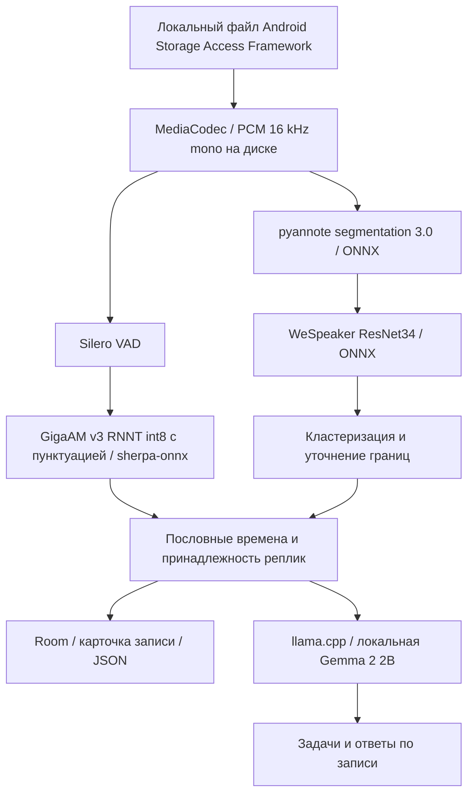

# Архитектура решения

## Контекст

Android-приложение превращает запись разговора в структурированную расшифровку: текст реплик,
говорящие и временные метки. Вся обработка идёт на устройстве, без сети и серверов.
Для конкурса добавлены JSON-экспорт по контракту задания, отдельная сборка без аккаунта
и модели внутри APK.

## Компоненты

Распознавание речи: GigaAM v3 (Сбер), RNNT-вариант (encoder, decoder, joiner), int8, с пунктуацией и заглавными, запускается через sherpa-onnx (ONNX Runtime).
Речь режется Silero VAD на фрагменты не длиннее 22 секунд; планировщик фрагментов делит границу по середине паузы, чтобы одно и то же слово не распознавалось дважды.
Пословные времена берутся из меток токенов. Только русский язык. Whisper в конкурсную APK не входит. LLM: Gemma 2 2B Q4_K_M в облегчённом
словаре ru90k; отвечает на вопросы по записи и выделяет главное, в расшифровку и JSON не вмешивается.

`AudioDecoder` и `FilePcm` используют файл PCM вместо загрузки всей длинной
записи в RAM. `StoredAudioTranscriber` обрабатывает сохранённое аудио кусками.
`SpeakerDiarizer` строит голосовые признаки, оценивает число групп и привязывает
слова к временной шкале. `SpeakerBoundaryRefiner` уточняет спорные границы.
`DiarizationJobRunner` сериализует тяжёлые задания, сохраняет прогресс и проверяет,
что результат не перезаписывает изменённый пользователем текст.

`RecordStorage` / Room сохраняют текст и ASR-интервалы. Метки голосов сохраняет
`SpeakerCentroidStorage`. `JsonTranscriptExporter` строит контракт по текущему
тексту и акустическим временным якорям; ID зависит от индекса голоса, а не имени.
Экспорт не запускает LLM и не отправляет текст или звук в сеть. Реплики нулевой длины не отменяют экспорт; JSON сохраняется в «Загрузки» автоматически после обработки.

## Основные технические решения

Native CPU-варианты выбираются по возможностям процессора. Vulkan загружается
динамически; на неподдерживаемом устройстве используется CPU. Пользовательский
замер производительности выбирает backend. LLM и ASR разделяют ggml runtime;
владение моделями ограничено, чтобы не держать все контексты без необходимости.

Модели можно положить внутрь APK при сборке (`-PguzlikvoiceBundle`, см. src/README.md): при первом
запуске приложение копирует их из APK в свою папку без интернета (`BundledModels`, экран «Подготовка
к работе»). Конкурсная APK 4.0.9 одна: внутри GigaAM v3 RNNT, Gemma 2 2B ru90k и модели диаризации/VAD, см.
[CONTEST_APK.md](CONTEST_APK.md). Сборки LIGHT/HEAVY с Qwen 0,6B относятся к разработке и в конкурсную сборку не входят.

## Зависимости

sherpa-onnx и ONNX Runtime (GigaAM v3, pyannote segmentation 3.0, WeSpeaker ResNet34, Silero VAD), llama.cpp (Gemma),
Room, Kotlin/Android SDK 36, NDK 25.1. Модели: GigaAM v3 RNNT int8, Gemma 2 2B Q4_K_M (ru90k),
Qwen3 0.6B (только в сборках разработки); контрольные суммы в config/contest-models.json.

## Безопасность и приватность

Все четыре модели инференса работают на Android. Компьютерные инструменты
бенчмаркинга нужны для разработки и не участвуют в обработке конкурсного аудио.

Экспорт не запускает LLM и не отправляет текст или звук в сеть; в сборке для конкурса нет входа и подписки.
