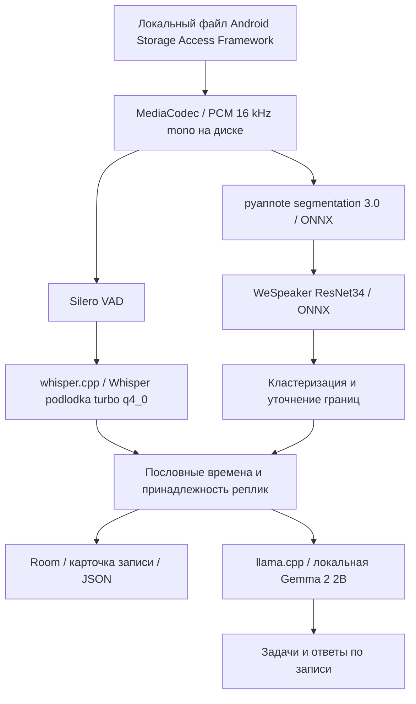

# Архитектура решения

## Контекст

Android-приложение превращает запись разговора в структурированную расшифровку: текст реплик,
говорящие и временные метки. Вся обработка идёт на устройстве, без сети и серверов.
по контракту задания, отдельная сборка без аккаунта и модели внутри APK.

## Компоненты

Whisper — дообученный на русской речи bond005/whisper-podlodka-turbo,
GGML q4_0. Основная LLM — Gemma 2 2B Q4_K_M, при необходимости облегчённый
словарь ru90k. Выбор альтернативной Qwen 0.6B остаётся экспериментальным;
для защиты рекомендуется Gemma с вопросами по записи.

`AudioDecoder` и `FilePcm` используют файл PCM вместо загрузки всей длинной
записи в RAM. `StoredAudioTranscriber` обрабатывает сохранённое аудио кусками.
`SpeakerDiarizer` строит голосовые признаки, оценивает число групп и привязывает
слова к временной шкале. `SpeakerBoundaryRefiner` уточняет спорные границы.
`DiarizationJobRunner` сериализует тяжёлые задания, сохраняет прогресс и проверяет,
что результат не перезаписывает изменённый пользователем текст.

`RecordStorage` / Room сохраняют текст и ASR-интервалы. Метки голосов сохраняет
`SpeakerCentroidStorage`. `JsonTranscriptExporter` строит контракт по текущему
тексту и акустическим временным якорям; ID зависит от индекса голоса, а не имени.
Экспорт не запускает LLM и не отправляет текст или звук в сеть.

## Основные технические решения

Native CPU-варианты выбираются по возможностям процессора. Vulkan загружается
динамически; на неподдерживаемом устройстве используется CPU. Пользовательский
замер производительности выбирает backend. LLM и ASR разделяют ggml runtime;
владение моделями ограничено, чтобы не держать все контексты без необходимости.

Модели можно положить внутрь APK при сборке (`-PguzlikvoiceBundle`, см. src/README.md): при первом
запуске приложение копирует их из APK в свою папку без интернета (`BundledModels`, экран «Подготовка
к работе»). Две сборки: LIGHT (распознавание, голоса, VAD, Qwen 0,6B, около 0,9 ГБ) и HEAVY (то же с
облегчённой Gemma 2 2B, около 1,9 ГБ).

## Зависимости

whisper.cpp (GGML), llama.cpp, ONNX Runtime (pyannote segmentation 3.0, WeSpeaker ResNet34), Silero VAD,
Room, Kotlin/Android SDK 36, NDK 25.1. Модели: Whisper podlodka-turbo q4_0, Gemma 2 2B Q4_K_M (ru90k),
Qwen3 0.6B; контрольные суммы в config/models.json.

## Безопасность и приватность

Все четыре модели инференса работают на Android. Компьютерные инструменты
бенчмаркинга нужны для разработки и не участвуют в обработке конкурсного аудио.

Экспорт не запускает LLM и не отправляет текст или звук в сеть; в сборке для конкурса нет входа и подписки.
