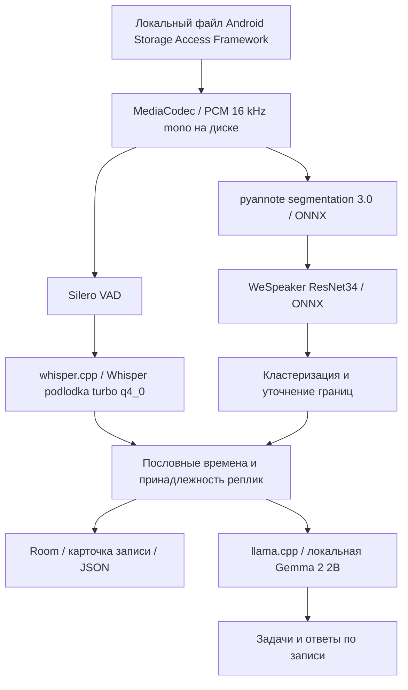

# Архитектура и модели

Whisper — дообученный на русской речи bond005/whisper-podlodka-turbo,
GGML q4_0. Основная LLM — Gemma 2 2B Q4_K_M, при необходимости облегчённый
словарь ru90k. Выбор альтернативной Qwen 0.6B остаётся экспериментальным;
для защиты рекомендуется Gemma с вопросами по записи.

`AudioDecoder` и `FilePcm` используют файл PCM вместо загрузки всей длинной
записи в RAM. `StoredAudioTranscriber` обрабатывает сохранённое аудио кусками.
`SpeakerDiarizer` строит голосовые признаки, оценивает число групп и привязывает
слова к временной шкале. `SpeakerBoundaryRefiner` уточняет спорные границы.
`DiarizationJobRunner` сериализует тяжёлые задания, сохраняет прогресс и проверяет,
что результат не перезаписывает изменённый пользователем текст.

`RecordStorage` / Room сохраняют текст и ASR-интервалы. Метки голосов сохраняет
`SpeakerCentroidStorage`. `JsonTranscriptExporter` строит контракт по текущему
тексту и акустическим временным якорям; ID зависит от индекса голоса, а не имени.
Экспорт не запускает LLM и не отправляет текст или звук в сеть.

Native CPU-варианты выбираются по возможностям процессора. Vulkan загружается
динамически; на неподдерживаемом устройстве используется CPU. Пользовательский
замер производительности выбирает backend. LLM и ASR разделяют ggml runtime;
владение моделями ограничено, чтобы не держать все контексты без необходимости.

Все четыре модели инференса работают на Android. Компьютерные инструменты
бенчмаркинга нужны для разработки и не участвуют в обработке конкурсного аудио.
